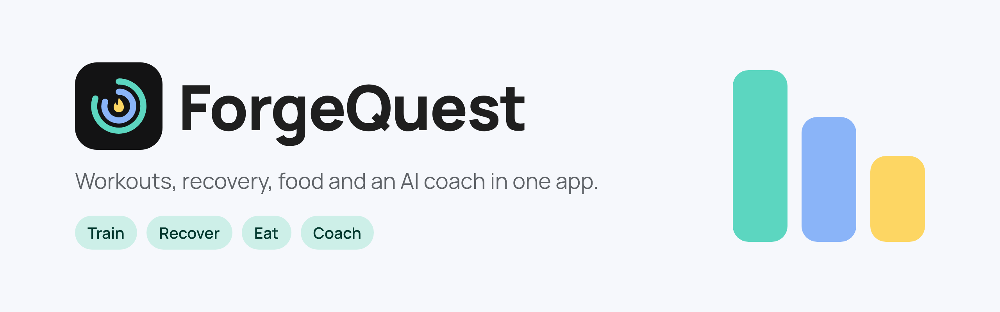
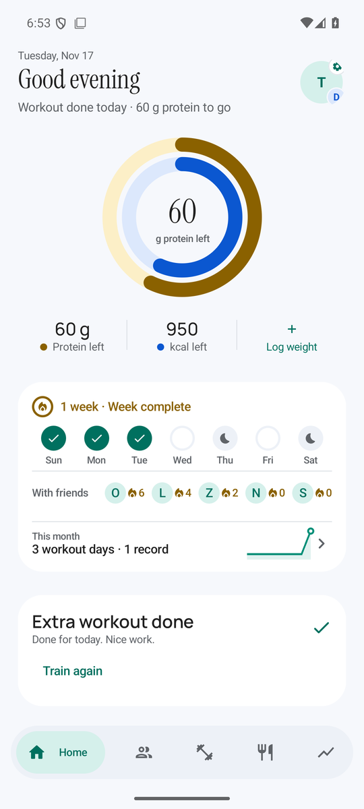
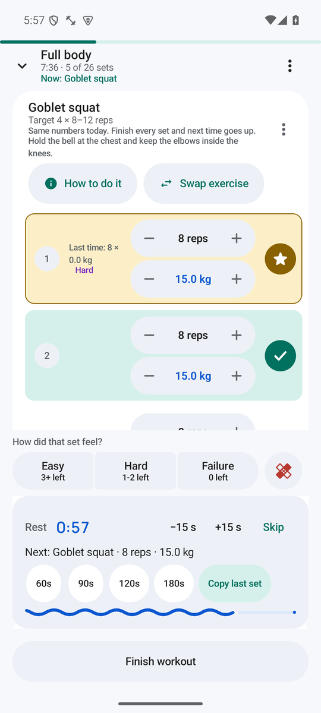
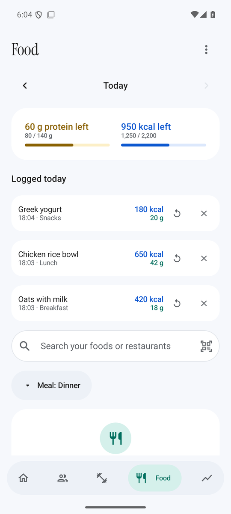
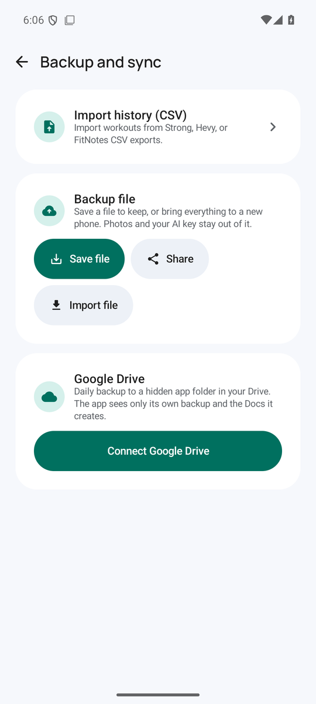

<div align="center">



**A calm workout and food tracker for Android, with a web version for any phone or computer.**

Follow a plan that fits your equipment, log every set, track protein and calories,<br>
and keep each other going with friends. No account needed; Friends is an optional Google sign-in.

[](apk/version.json)
[](#install)
[](https://caelumop.github.io/ForgeQuest/)
[](#languages-and-looks)

[**Download the APK**](https://github.com/CaelumOP/ForgeQuest/raw/main/apk/ForgeQuest.apk) ·
[**Open the web app**](https://caelumop.github.io/ForgeQuest/) ·
[Privacy](PRIVACY.md)

</div>

<table align="center">
<tr>
<td align="center"><br><sub><b>Home</b> · today's workout, rings, streak</sub></td>
<td align="center"><br><sub><b>Workout</b> · log sets as you go</sub></td>
<td align="center"><br><sub><b>Food</b> · protein and calories</sub></td>
<td align="center"><br><sub><b>Backup</b> · your own Google Drive</sub></td>
</tr>
</table>

## What it is

ForgeQuest helps you train consistently. It gives you a plan, shows you what to do today, records every
set, and tells you when to add weight or reps. It also tracks what you eat against a protein and calorie
target. The app opens straight on Home with no setup; you add details when you need them.

Everything is stored on your device. Nothing leaves it unless you turn on a feature that needs it
(see [What leaves your device](#what-leaves-your-device)).

## Features

### Plans

- **10 ready-made plans:** Hemo · Foundation level, Full body (bodyweight, dumbbells or gym), Push · Pull · Legs,
  Upper / lower (gym or dumbbells), Calisthenics level 2, Minimal 2 days, and Zero equipment.
- **Plan builder:** answer a few questions (goal, experience, days, equipment) and get a plan, made on the device.
- **Two schedule types:** fixed weekdays, or a rotation that moves to the next workout whenever you finish one.
  If you miss a day, one tap moves it to today.
- **Supersets and circuits:** pair two exercises, or run a group round by round.
- **Automatic warm-up sets** for heavy lifts (optional, per exercise).
- **Progression per exercise:** add reps until the top of the range and then add weight, add weight every
  session, or hold steady. Every 4th week is a lighter deload week.
- **Share a plan** with someone as a file or text, and import one with a preview first.
- **Change plan** at any time: builder, ready-made, import, or go back to a previous plan.

### Exercises

- **861 exercises:** 736 training moves and 125 stretches and mobility holds.
- **Start and finish photos** for most exercises, plus 2 form cues and 1 common mistake for each built-in one.
- **Arabic names** for every exercise, using the words people use in the gym. Search finds exercises by
  English or Arabic name and by common short names (for example RDL, بنش، لات).
- **Filters** by equipment, muscle, or by tapping a muscle on a front and back body map.
- **Swap** any exercise for one that fits your equipment, marked Easier, Same or Harder.
- **Your own exercises:** create, edit, merge or delete them, with their muscles, equipment and kg or lb.

### During a workout

- Sets are filled in from last time; tick each one as you finish it.
- **Number pad** with quick +/- buttons and "Last time".
- **Plate calculator** for barbell lifts: which plates to put on each side.
- **Set types:** working, warm-up, drop set, failure and rest-pause. Only working and failure sets count
  toward progress and records.
- **Effort after each set:** Easy (3 or more reps left), Hard (1–2 left) or Failure (none left),
  and a separate **Pain** button to note anything that hurt.
- **Rest timer** with 60, 90, 120 and 180 second presets, ±15 seconds, skip, and an alarm when rest ends.
- **Hold timer** for timed moves, with a 3-2-1 start.
- **Quick look** at an exercise (photos, cues, recent history) without leaving the workout.
- **Setup notes** you pin to an exercise, such as a seat height.
- **Personal records** marked the moment you set them.
- **Spoken cues** for rest and holds (optional).
- **List view or focus view** (one exercise at a time).
- **Summary at the end** with a workout score, your records and a short review, which you can share as text.

### Progress

- Charts per exercise over 1 month to all time, and weekly training load.
- **Estimated one-rep max** with a percentage table, and strength compared to body weight.
- **Body measurements:** arms, chest, hips, thighs and waist.
- **Muscle map** showing what you trained this week and what is still recovering.
- **Journal:** every week and workout, with notes, scores and details. You can delete a workout and undo it.
- **43 badges** for consistency, skills, strength and nutrition, plus XP, levels and ranks (E to S).
- **Weekly streak** that planned rest days and days you mark as sick, injured or travelling never break.

### Food

- Rings for protein, calories and (optional) carbs, with targets for cutting, maintaining or gaining.
- **Quick log**, **Log again** for past meals, and saved foods with portions.
- **Barcode scan** with product details from Open Food Facts. It works offline for products you've scanned before.
- **With your own free Gemini key (optional):** estimate a food from its name, scan a meal photo, or read a
  nutrition label. Without a key you can copy a prompt into the Gemini app and paste the answer back.
- A 7-day view with averages and how many days you hit your targets.

### Friends (optional)

- Sign in with Google, pick a @username, and add friends.
- **Weekly leaderboard** with places shown as 1ST, 2ND, 3RD, and shared streaks with each friend.
- **ForgeScore**, which starts at 0 every Sunday and only goes up:
  - workout days done ÷ your weekly target × 100 (up to 100), then
  - +5 for each new record (up to 2), +2 for each day you hit your protein target (up to 3),
    and +5 for training more than your target, with at most +20 in bonuses.
  - Tap your score to see your own breakdown.
- **Go train 💪:** send a friend a nudge, once a day.
- **Inbox** with friend requests, nudges and friends' finished workouts, and notifications for them.
- **Privacy switches:** choose whether to share your photo and records, and whether to get alerts. Mute or block anyone.

### Backup and moving your data

- **Automatic backup to your own Google Drive** once you connect it (in a private app folder only ForgeQuest can see).
  You can turn it off. On a new phone, the app offers to restore your backup.
- **Export and import a backup file** yourself.
- **Import your history** from Strong, Hevy or FitNotes (CSV files).

### Languages and looks

- English and Arabic, with full right-to-left layout.
- Light, dark or system theme.
- kg or lb, with a per-exercise override; your barbell weight and plates are adjustable.

## What leaves your device

Nothing, unless you use one of these:

| Feature | What is sent | Where |
|---|---|---|
| Friends | Your @username, photo (if you share it), and this week's summary: workout days, target, score, streak, protein days and records count | The ForgeQuest Friends server |
| Google Drive backup | Your backup file (without AI keys) | Your own Google Drive |
| Gemini features | The meal photo, label photo or food name you choose to send | Google Gemini, with your own key |
| Barcode scan | The barcode number | Open Food Facts |

Full details are in the [privacy policy](PRIVACY.md).

## Install

**Android (8.0 or newer)**

1. Download [**ForgeQuest.apk**](https://github.com/CaelumOP/ForgeQuest/raw/main/apk/ForgeQuest.apk) on your phone.
2. Open it and allow "install unknown apps" when Android asks.

The app checks for new versions and can install them itself. You can also follow releases with
[Obtainium](https://github.com/ImranR98/Obtainium) using `https://github.com/CaelumOP/ForgeQuest`.

**Web (iPhone, other phones, computers)**

Open [caelumop.github.io/ForgeQuest](https://caelumop.github.io/ForgeQuest/) and add it to your Home Screen;
the app asks you to do this first. After that it works offline. A few things are Android only:
Health Connect (steps, calories burned and weight), the update installer and the rest-alarm notification.

**Gemini key (optional):** create a free key at [aistudio.google.com/apikey](https://aistudio.google.com/apikey)
and paste it in Settings.

## Build from source

Android: Kotlin, Jetpack Compose, Material 3 and Room. Web: Preact and Vite. Friends server: Cloudflare Workers and D1.

```
./gradlew assembleDebug        # Android debug APK
./gradlew testDebugUnitTest    # Android unit tests
cd web && npm install && npm run build && npx vitest run
cd worker && npm install && npx vitest run
```

Signing, Google Drive and Friends server setup are in the [setup guide](docs/SETUP.md).

## Credits

- Foundation routine: [Hemo Calisthenics](https://www.youtube.com/@HemoCalisthenics); his exercises link to the moment they're shown in his videos.
- Exercise data and photos: [free-exercise-db](https://github.com/yuhonas/free-exercise-db), released into the public domain (Unlicense).
- Anatomy art: [react-native-body-highlighter](https://github.com/HichamELBSI/react-native-body-highlighter) 3.2.0, MIT License © 2022 ELABBASSI Hicham.
- Food data: [Open Food Facts](https://world.openfoodfacts.org/) (ODbL).
- Web barcode reading: [barcode-detector](https://github.com/Sec-ant/barcode-detector) (ZXing).
- Fonts: [Manrope](https://fonts.google.com/specimen/Manrope) ([licence](docs/licenses/Manrope-OFL.txt)) and [IBM Plex Sans Arabic](https://github.com/google/fonts/tree/main/ofl/ibmplexsansarabic) ([licence](docs/licenses/IBMPlexSansArabic-OFL.txt)), SIL Open Font License.
