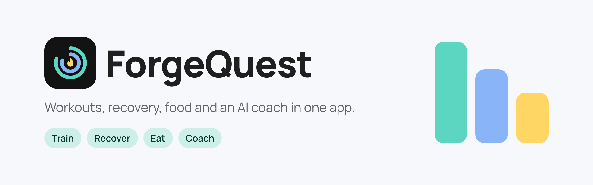
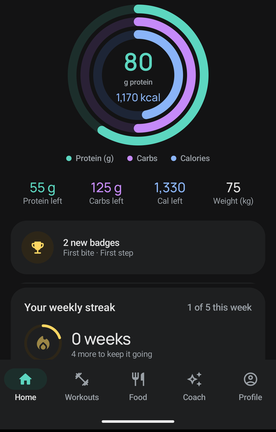
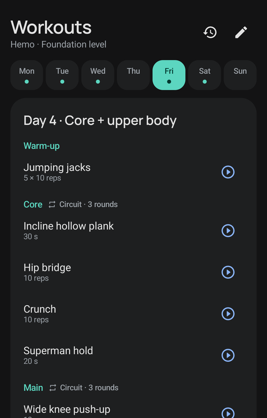
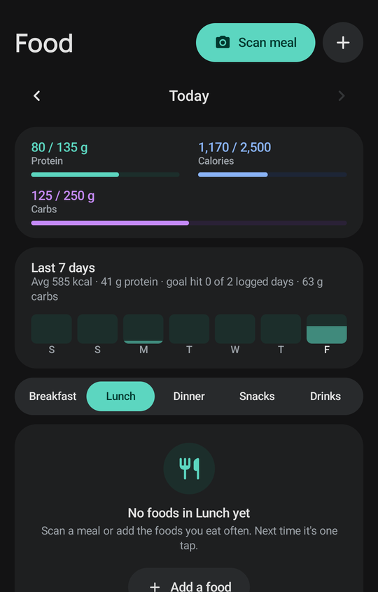
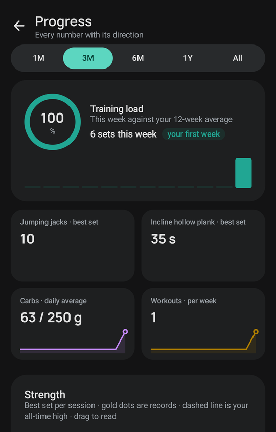
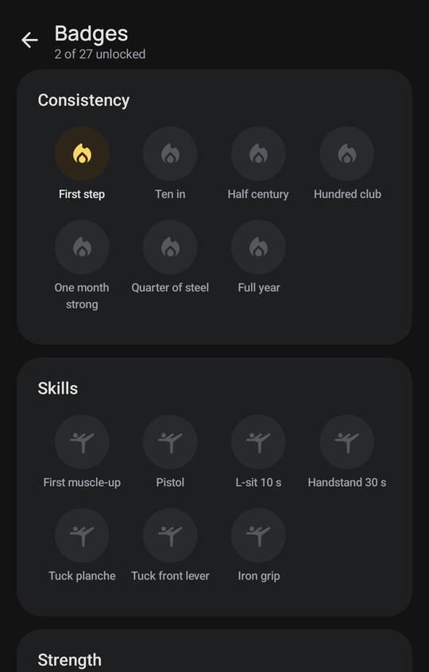
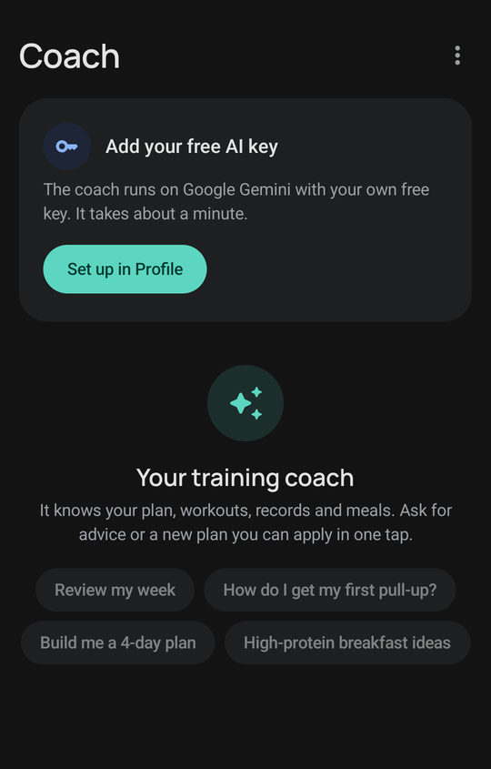

<div align="center">



**A calm, smart workout companion for Android.**

Train on a plan that fits your equipment, log every set, watch your muscles recover,<br>
track protein and calories, and ask an AI coach, all without an account.

[](apk/version.json)
[](#install)
[](app)
[](#data-and-privacy)

[**Download the APK**](https://github.com/CaelumOP/ForgeQuest/raw/main/apk/ForgeQuest.apk) ·
[Privacy](PRIVACY.md) ·
[Setup guide](docs/SETUP.md) ·
[Spec](SPEC.md)

</div>

<table align="center">
<tr>
<td align="center"><br><sub><b>Home</b> · protein, carbs and calorie rings</sub></td>
<td align="center"><br><sub><b>Workouts</b> · today's plan, day by day</sub></td>
<td align="center"><br><sub><b>Food</b> · meals, goals and the week</sub></td>
</tr>
<tr>
<td align="center"><br><sub><b>Progress</b> · training load and trends</sub></td>
<td align="center"><br><sub><b>Badges</b> · consistency, skills, strength</sub></td>
<td align="center"><br><sub><b>Coach</b> · Gemini with your own key</sub></td>
</tr>
</table>

## Why ForgeQuest

Most people don't quit training because the plan was wrong. They quit because they burned out or fell
off for a week and never came back. ForgeQuest is built around staying consistent: weekly streaks that
planned rest days never break, calm XP and badges instead of loud rewards, readiness from your sleep
and heart rate, and an easy way back in after a sick day or a break.

No account, no server, no ads. Your data stays on your phone, with an optional backup to your own
Google Drive.

## Features

**Training**

- A live workout screen: sets prefilled from last time, a "Previous" column, tick to confirm, rest timer
  between sets, and a list or focus mode with Now and Next.
- Hold timer for timed moves: 3-2-1 get-ready, countdown with vibration cues, and extra time counted in gold.
- Personal records detected as you go, with a quiet gold PR tag and a summary at the end.
- About 90 built-in exercises across calisthenics, skills, dumbbells, kettlebells and gym lifts, each with
  a form video link (Hemo's moves jump straight to the moment in his videos).
- A kg box and an "Add weight" switch for bodyweight moves, and a one-tap effort chip after each set.
- An AI debrief after each workout, plus a journal where weeks expand into days and every workout can
  carry a note.

**Plans**

- Starter plans: Hemo's Foundation level, Full body 3 days, and Push · Pull · Legs for the gym.
- A Change plan sheet: build one with Gemini, pick a ready-made plan, go back to a previous one, or
  import a Google Doc.
- An equipment picker (gym, home, dumbbells, kettlebells and more), so swaps and plans only use what you own.
- Calm progression that adds reps or load only when you've earned it, with a biomechanical exercise swapper.
- Sick and travel days that pause the plan without hurting your streak.

**Recovery and readiness**

- A muscle recovery map on real anatomy art, front and back, coloured by what's still recovering.
- Readiness, sleep and strain dials from Health Connect (Fitbit and other sources), with detail pages and
  60-day baselines.
- On low-recovery mornings it offers a lighter session or a rest day.
- Workouts logged in other apps count toward your strain.

**Nutrition**

- Protein, carbs and calorie rings, with goals for Cut, Maintain or Gain worked out from your activity level.
- Photo meal scan with Gemini, or share the photo to the Gemini app and import the result.
- Quick log, a tick-what-you-ate list by meal, and a 7-day view.

**AI coach**

- Runs on Google Gemini with your own free key, with Groq as an optional fast chat provider.
- Knows your plan, workouts, records, recovery and meals, and remembers lasting notes like an injury or
  your equipment.
- Builds or edits plans you apply in one tap, with safety checks on what it suggests.
- An optional bridge to the Gemini app through two Google Docs.

**Motivation**

- A weekly streak flame. Planned rest days never break it.
- Subtle XP and ranks, 27 badges for consistency, skills, strength and nutrition, and haptics instead of sounds.
- A gentle "welcome back" that offers an easier first session after time off.

**Data and privacy**

- Everything is stored on the phone. Backup and restore with your own Google Drive, or export a JSON file.
- English and formal Arabic, with full right-to-left layout.
- The app checks for updates itself and shows what's new.
- Light and dark themes that follow your system.

Read the [privacy policy](PRIVACY.md) for exactly what leaves the phone and when.

## Install

1. Download [**ForgeQuest.apk**](https://github.com/CaelumOP/ForgeQuest/raw/main/apk/ForgeQuest.apk) on your phone.
2. Open it and allow "install unknown apps" when Android asks.
3. Follow the short setup: your name, weight and goals, a starting plan, and an optional free AI key.

ForgeQuest needs Android 8.0 or newer. From 2.6.0 on, the app tells you when an update is ready.

To turn on the AI features, open [aistudio.google.com/apikey](https://aistudio.google.com/apikey), create a free
key and paste it in **Profile → AI key**.

## Build from source

ForgeQuest is a native Kotlin app built with Jetpack Compose, Material 3 and Room.

```
./gradlew assembleDebug        # → app/build/outputs/apk/debug/app-debug.apk
./gradlew testDebugUnitTest    # streak, XP, recovery, records, plan parsing
```

Release signing, the Google Drive setup and how the coach works are in the [setup guide](docs/SETUP.md).

## Credits

- Foundation routine: [Hemo Calisthenics](https://www.youtube.com/@HemoCalisthenics), with each exercise linked to the moment it's shown in his videos.
- Anatomy art: [react-native-body-highlighter](https://github.com/HichamELBSI/react-native-body-highlighter) 3.2.0, MIT License © 2022 ELABBASSI Hicham. Converted into `app/src/main/assets/body_map.json`.
- Font: [Manrope](https://fonts.google.com/specimen/Manrope), SIL Open Font License ([licence](docs/licenses/Manrope-OFL.txt)).
